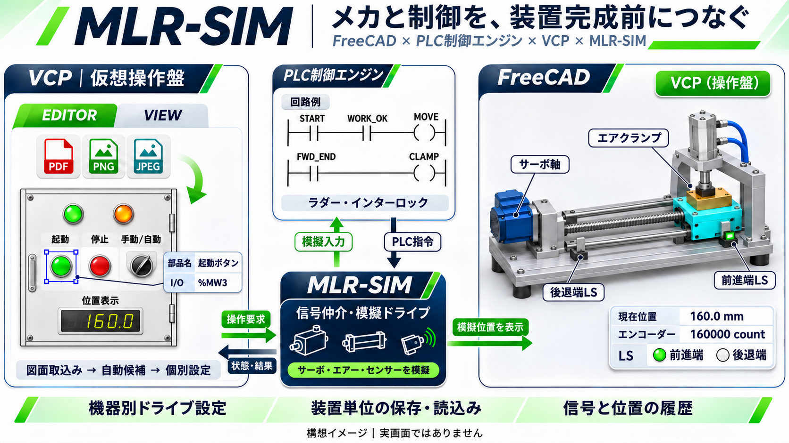
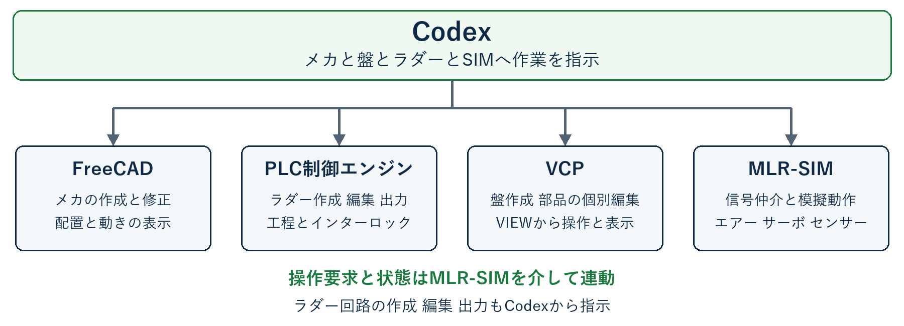
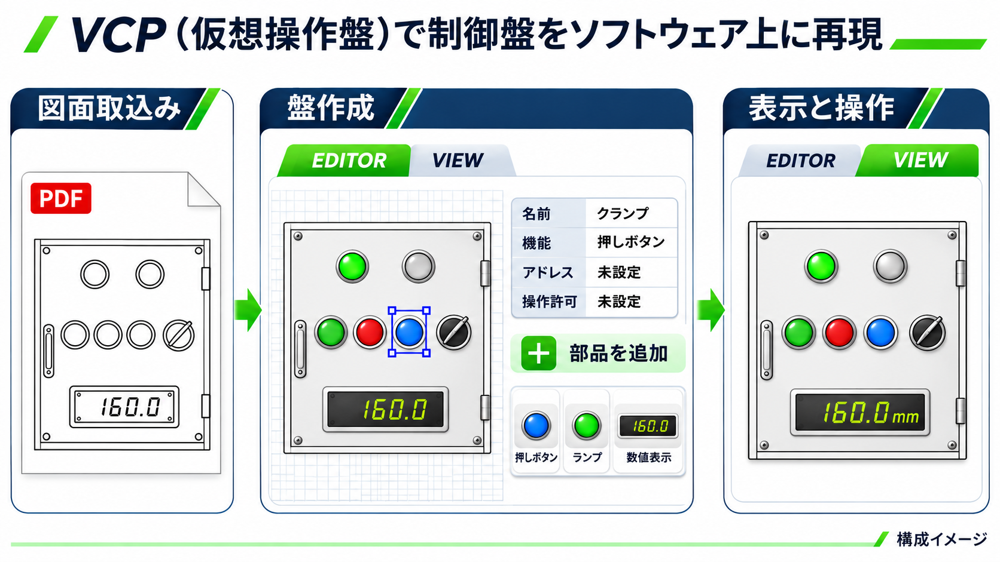

# MLR-SIM

**メカ・PLC回路・操作盤をつなぎ、設備を製作する前に動作の整合を確認する。**

MLR-SIMは、設備立上げ時の手戻りを減らすことを目指して制作している、オリジナルの設備シミュレーションアプリです。機械設計、制御設計、生産技術の担当者が、同じ装置モデルを使って工程と操作を検討できる環境をつくります。

## なぜつくるのか

設備の立上げでは、メカが組み上がってから「動作が成立しない」「干渉する」「回路と機構の条件が合わない」「必要な操作や信号が足りない」と分かることがあります。現場での修正が重なると、工程全体に影響します。

MLR-SIMでは、CAD上の機構、PLCの工程・インターロック、仮想操作盤を連動させることで、こうした不整合を設備製作前に見つけやすくすることを目指します。

## 4つの機能をひとつの装置につなぐ

| 構成 | 役割 |
| --- | --- |
| FreeCAD | メカの形状・配置を設計し、機構の動きを表示 |
| PLC制御エンジン | ラダー回路、工程順序、通常インターロックを扱う |
| VCP（Virtual Control Panel） | ユーザーの盤図面から、編集と操作ができる仮想操作盤を作成 |
| MLR-SIMモジュール | I/Oの仲介、サーボ・エアーの模擬動作、位置・エンコーダー・センサー情報の管理 |

Codexから各アプリへ指示し、盤の編集、ラダー回路の作成・編集・出力、機構・ドライブ設定、シミュレーションの操作と結果確認までを一連の作業として扱う構成です。

## 自分の盤図面を、操作できる画面へ

VCPは、盤を作る **EDITOR** と、操作・状態確認を行う **VIEW** を兼ねる専用アプリです。

- PDFや画像の盤図面を取り込み、ボタン・ランプ・表示器などの候補を生成し、ユーザーが確認・修正。
- 部品ごとに、配置、機能、名前、I/Oアドレス、操作許可・完了・不許可理由の参照先を設定。
- ボタン、ランプ、数値表示、数値入力などを新規追加し、設定済み部品を再利用。
- 図面と部品設定、I/O対応、ドライブ設定を装置単位で保存・読込み。
- VIEWの操作要求をPLCへ渡し、PLCの判定、模擬メカの動き、センサー結果を画面へ反映。

図面からの生成結果は候補として扱い、読み取れない名称やアドレスを勝手に確定しない設計です。

## サーボとエアーで工程を確認

デモで扱う工程は、サーボスライドがワークを前進端へ運び、前進端の固定架台にあるエアークランプでワークを押さえる動作です。指令だけでなく、位置、前進端・後退端のセンサー、クランプ完了、操作許可の関係を確認します。

サーボ軸やエアー機器ごとのストローク、速度、位置換算、エンコーダー情報などを管理し、装置の設定として保存できる構成を目指します。

## 現在の段階

VCPと各連動モジュールの制作・個別検証を進めています。上の画像は構成と操作例のイメージです。全アプリを通した実環境での連動確認と、実機での適合確認は未完了です。

このリポジトリでは、MLR-SIMの目的、構成、目指す使い方を紹介します。
